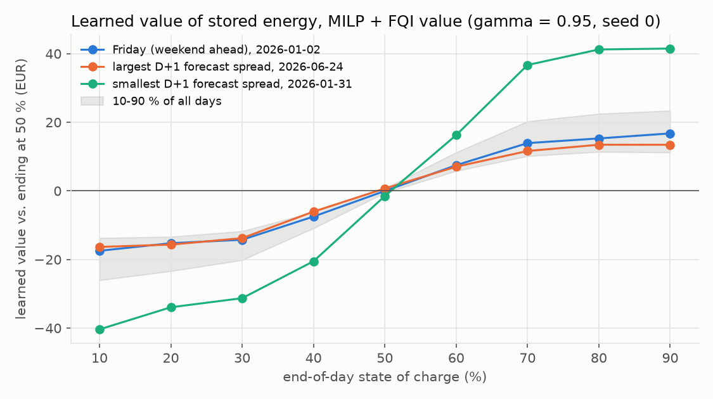
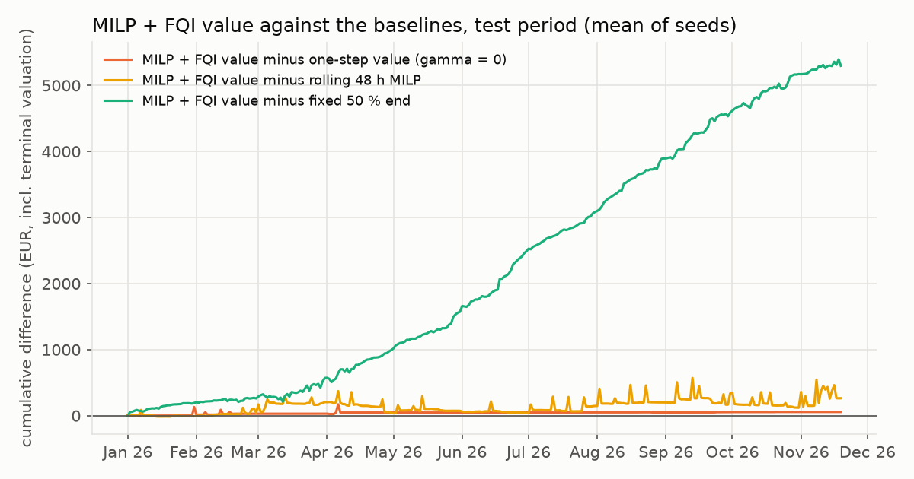
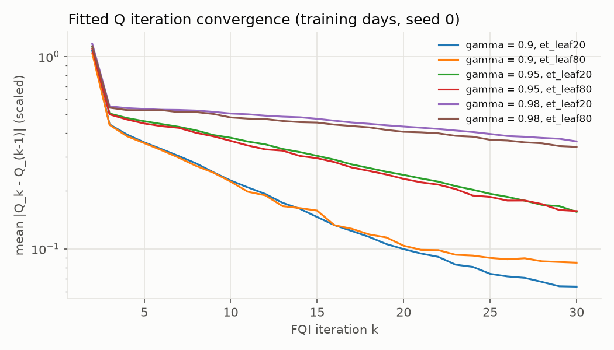

# Offline Reinforcement Learning and MILP for Day-Ahead Battery Arbitrage

A day-ahead MILP plans one battery day at a time. It sees 24 hours and nothing after, so it cannot tell
how much energy it should keep for tomorrow. An earlier version of this project showed that an end-to-end PPO policy
on the open-loop day-ahead problem at best matches a MILP that uses the same forecast. This project therefore
moves reinforcement learning to the value layer: **fitted Q iteration (FQI) learns what the energy left at
midnight is worth**, and that value enters the 24-hour MILP as a terminal value. The MILP keeps the hard
intra-day constraints and the 15-minute plan; settlement always uses realised prices.

This is a controlled test of an RL-augmented EMS optimiser on the German (DE-LU) day-ahead market, not a
new algorithm.

> Problem setting inspired by the Huawei Nuremberg Tech Arena 2025 (EMS/BESS track); independent personal project, not a competition submission.

**Research questions**

- **Q1 (main)**: How much does the FQI-learned end-of-day SoC value, used as terminal value of the 24 h MILP,
  earn over a fixed 50 % end, a constant residual value and a one-step (non-bootstrapped) value? How much of the
  48 h rolling MILP's advantage does it recover?
- **Q2 (is the gain from RL?)**: Is multi-step bootstrapping (gamma > 0) better than the one-step value (gamma = 0,
  same features and model)? Only if this paired interval excludes zero can a gain be attributed to RL.
- **Background (earlier version; its PPO code is not part of this repository)**: end-to-end PPO on the open-loop day-ahead
  problem only matches the MILP; this negative result is why RL sits at the value layer here.

**Short answer** (details in *Results*). The single external reference is the ISEA Battery Revenue Index
(RWTH Aachen); the headline run uses the index's battery. On the 2026 test (retrospective, 322 days matched with the
index's daily values) the MILP with the FQI-learned value (**MILP + FQI value**) earns **92.4 % of the ISEA day-ahead index** (88.9 % when
the 11 days the index reports as zero are dropped from both sides), against 86.0 % for a fixed 50 % end of day.
It beats the fixed 50 % end and the 48 h rolling MILP significantly. **It does not beat the one-step value (gamma = 0),
and it is slightly but significantly below a free end of day with no value** (-0.8 EUR/day [-1.4, -0.2]). With the
project battery the picture is the same (minus the one-step value: +0.2 EUR/day [-0.5, 0.9]). The gain over the fixed 50 % end comes from
letting the end-of-day SoC float; the results do not support a gain from RL's multi-step bootstrapping.

## Problem setting and timing rules

<picture>
  <source media="(prefers-color-scheme: dark)" srcset="docs/diagrams/timing-dark.svg">
  
</picture>

- Every decision for delivery day **D** uses only information published by the DA gate closure, **D-1 12:00**
  (Europe/Berlin): prices of delivery days <= D-1. Realised prices of D are used **only for settlement** (and
  inside the reward of the learning problem). Enforced in code (`MarketData.known_at`,
  `check_information`) and covered by unit tests (`tests/test_no_lookahead.py`, `tests/test_rlvalue.py`).
- The whole day is planned at once and locked, as in the DA auction. Since delivery day **2025-10-01** the
  auction clears **15-minute** products; every day is scheduled at its native resolution.
- Delivery days are local days in Europe/Berlin: 23/24/25 hourly steps or 92/96/100 quarter-hours on DST days
  (`tests/test_dst.py`). Price taker: the battery's bids do not move the clearing price.

**Battery** (`configs/battery.yaml`): 1 MW / 2 MWh, charge and discharge efficiency sqrt(0.90) each (90 % round
trip), SoC 10-90 %, degradation cost 10 EUR per MWh discharged.

**Periods** (`configs/v2.yaml`)

| Use | Delivery days | Resolution |
|:--|:--|:--|
| Reward cache | 2021-01-01 - latest (2020 has no earlier year for the forecaster) | native |
| FQI fitting | 2021-01-01 - 2024-12-31 | 60 min |
| Validation (all hyper-parameters) | 2025-01-01 - 2025-12-31 | 60 min, 15 min from 2025-10-01 |
| Test (**retrospective**) | 2026-01-01 - 2026-11-22 | 15 min |
| Acceptance | delivery days after 2026-11-22 (freeze date) | 15 min |

The 2026 test period was already looked at in an earlier version, so its numbers here are a **retrospective evaluation**, not a
sealed test. The plan took effect on 2026-11-22; delivery days after that date form the acceptance set
(no data yet). No 2026 data was used for fitting or selection, and the test was run once after selection.

SMARD's `quarterhour` series before 2025-10-01 repeats the hourly price four times (verified for 100 % of hours by
`scripts/download_data.py`), so it is not used as 15-min data. Missing values are reported and the affected days
excluded, never interpolated.

## Method

<picture>
  <source media="(prefers-color-scheme: dark)" srcset="docs/diagrams/scheme-dark.svg">
  
</picture>

The scheme has five modules, read from left to right: **(1) input** prices from SMARD, split into prices
published by gate closure and the realised prices of D; **(2) forecasting** with XGBoost; **(3) reinforcement
learning**, offline: a reward cache of daily MILPs trains fitted Q iteration, which yields a terminal SoC value;
**(4) MILP scheduling**: each day the 24 h MILP plans on the forecast with that terminal value; **(5) output**:
the plan is settled at realised prices in a chained backtest and compared with the ISEA index. Realised prices of D
reach only the reward cache and the settlement (dashed lines), never the planner.

**Forecasts.** XGBoost on gate-closure information only (lagged prices of D-1, D-2, D-7, level and shape of D-1,
calendar, German holidays), one model for D and one for D+1. It uses **forward-chaining folds** for every day
(`src/bess/rlvalue/forecasts.py`): the model that forecasts at gate closure of D was fitted only on days before
1 January of D's year, with early stopping on the latest 15 % of those days. The fold is chosen by the decision
day D (also for the D+1 forecast), so a model never contains a price that was unpublished at gate closure.
For 15-min days the hourly forecast is forward-filled.

**MDP, one step per day.** State s_D = (start level e_s, phi_D), with 9 SoC levels 10 %, 20 %, ..., 90 % and gate-closure
features phi_D: statistics of the forecast of D and of D+1 (mean, standard deviation, mean of the 2 highest and 2
lowest hours, max - min, top - bottom), day of week and month (sin/cos), holiday flags of D and D+1, weekend flag of
D+1, resolution flag (`src/bess/rlvalue/features.py`). Action: end level e_e (9 levels); the next day starts at it.
Reward R[D, e_s, e_e]: the daily MILP on the forecast of D, from e_s to exactly e_e, settled at realised prices,
net of degradation cost. Every pair of levels is reachable within one day, including 23-hour days (tested).

**Reward cache** (`src/bess/rlvalue/cache.py`, `scripts/build_reward_cache.py`): all 81 (e_s, e_e) MILPs for every
day, i.e. **174,069 MILPs for 2,149 days** (2021-01-01 to 2026-11-19), in 20 minutes with 6 processes, 0 constraint
violations. It stores the realised reward R and the forecast objective F. **Because every action is computed for
every day, the offline data set covers the whole action space**: fitted Q iteration never has to extrapolate to
actions missing from the data, the usual failure mode of offline RL. Tests check the cache against direct MILP
solves and that e_s = e_e = 50 % reproduces the daily MILP with a fixed 50 % end.

**Fitted Q iteration** (`src/bess/rlvalue/fqi.py`): Q(phi_D, e_s, e_e) with sklearn ExtraTrees,
Q_k = fit(R + gamma * max_a' Q_{k-1}(phi_{D+1}, e_e, a')); a day whose successor is missing is terminal. Rewards
are divided by the mean daily perfect-foresight revenue of the training days (154.8 EUR). gamma = 0 gives the
one-step model (no bootstrapping) with the same features and model.

**Using the value.** The continuation value of ending day D at level e is V(phi_{D+1}, e) = max_a' Q(phi_{D+1}, e, a').
phi_{D+1} is only known at gate closure of D+1, so a projection W(phi_D, e) is fitted to V(phi_{D+1}, e) - V(phi_{D+1}, 50 %).
- **MILP + FQI value (main method)**: the 24 h MILP gets 9 mutually exclusive binaries z_k with e_end = sum_k z_k e_k and adds
  sum_k z_k W_k (EUR) to its objective (`TerminalValue` in `src/bess/optim/milp.py`). The weight of W is 1 for every
  gamma: gamma acts inside the Bellman targets. With a weight of gamma, as first sketched in the plan, gamma = 0
  would remove the value altogether and make the one-step ablation identical to the free end.
- **FQI picks the end level** (variant): Q picks the end level, e_e = argmax_a Q(phi_D, e_s, a); the MILP plans the day to it.

**Chained backtest** (`src/bess/backtest/chain.py`): every method runs day after day and carries its end-of-day SoC.
Each period starts at 50 %; a chain breaks at a missing day and all methods restart at 50 %. At the end of every
chain the energy above or below 50 % is valued at the period's mean realised price times the discharge efficiency,
for every method alike. Baselines, all on the same forward-fold forecasts:

| Method | Definition |
|:--|:--|
| Perfect foresight | realised prices, end fixed at 50 % (reference; an upper bound only for strategies that end every day at 50 %) |
| Fixed 50 % end | daily MILP, end fixed at 50 % |
| Free end, not valued | daily MILP, end free and not valued |
| Constant end value | daily MILP, end energy valued at a constant EUR/MWh, chosen on validation (project battery 30, ISEA battery 0 EUR/MWh) |
| One-step value (gamma = 0) | the main method with gamma = 0, same features and tree setting: learned, but no multi-step bootstrapping |
| Rolling 48 h MILP | plans D and D+1, executes D, SoC carried over |

**Selection** (`scripts/train_fqi.py`): gamma in {0, 0.9, 0.95, 0.98}, iterations K in {10, 20, 30}, two tree settings
(minimum leaf 20 or 80), each scored by the chained backtest of the main method on validation. Chosen: project battery gamma = 0.95,
K = 30, leaf 20; ISEA battery gamma = 0.9, K = 30, leaf 80. The one-step value is gamma = 0 with the same tree setting. The chosen settings
are fitted with seeds 0, 1, 2 (ExtraTrees `random_state`) and, for the test, refitted on 2021-2025.

**Two battery profiles.** `configs/v2_isea.yaml` (headline) uses the ISEA index battery (`configs/battery_isea.yaml`:
1 MW / 2 MWh, 95 % each way, SoC 0-100 %, i.e. 11 levels and 121 MILPs per day, at most 2 cycles per day counted as
energy added to the store as in the index code, no degradation cost); `configs/v2.yaml` uses the project battery
(SoC 10-90 %, 9 levels, 10 EUR/MWh degradation, no cycle limit). Both share the forecasts and the pipeline.

## Results

All numbers come from `results/v2_isea/` (ISEA battery) and `results/v2/` (project battery): `summary_<period>.csv`,
`paired_<period>.csv`, `isea_share_<period>.csv`, `b2_grid.csv`, `fqi_grid.csv`, `fqi_choice.json`. Net revenue
includes the terminal valuation. Learned-value rows are the mean of **3 seeds**. All methods: 0 constraint violations.

### Headline: share of the ISEA day-ahead index (ISEA battery)

Ratio of sums over the same delivery days, ISEA's published daily DA values (2 h, 2 cycles) as denominator; 95 %
interval from 7-day blocks resampling both sides together. "Literal" keeps the days the index reports as zero;
"zero days dropped" removes them from both sides.

| Method | Test 2026, literal (322 days) | Test, zero days dropped (311) | Validation 2025, literal (365) |
|:--|--:|--:|--:|
| Perfect foresight, end at 50 % (backtester check) | 103.9 % [101.6, 107.0] | 100.3 % [100.2, 100.4] | 101.0 % |
| Free end, not valued | 92.6 % [89.2, 96.6] | 89.2 % | 93.2 % |
| Constant end value (0 EUR/MWh chosen) | 92.6 % [89.2, 96.6] | 89.2 % | 93.2 % |
| **MILP + FQI value (main, 3 seeds)** | **92.4 % [88.9, 96.4]** | **88.9 %** | **93.5 %** |
| One-step value, gamma = 0 (3 seeds) | 92.4 % [89.0, 96.4] | 89.0 % | 93.3 % |
| Rolling 48 h MILP | 90.9 % [87.3, 94.9] | 87.7 % | 91.5 % |
| FQI picks the end level (3 seeds) | 90.1 % [86.8, 94.0] | 86.8 % | 92.1 % |
| Fixed 50 % end | 86.0 % [83.1, 89.7] | 82.8 % | 87.9 % |

**Paired daily differences, ISEA battery** (mean of seeds, EUR/MW per day, 95 % interval)

| Comparison | Test | Validation |
|:--|:--|:--|
| **Main minus one-step value (Q2)** | -0.1 [-0.8, 0.6], **not significant** | +0.6 [-0.4, 1.7], not significant |
| Main minus free end | **-0.8 [-1.4, -0.2]**, main lower | +0.7 [+0.1, +1.6] |
| Main minus constant end value | -0.8 [-1.4, -0.2], main lower | +0.7 [+0.1, +1.6] |
| Main minus rolling 48 h MILP | +4.4 [+1.4, +8.4] | +4.8 [+2.4, +7.1] |
| Main minus fixed 50 % end | +19.4 [+15.8, +23.7] | +13.7 [+11.7, +16.2] |
| FQI picks the end level minus one-step value | -7.3 [-10.8, -4.2] | -2.9 [-4.8, -1.1] |

"Main" is MILP + FQI value. Its small validation edge over the free end (on the period its settings were chosen on) reverses on the test.

### Project battery

**Test period, 2026-01-01 - 2026-11-19 (retrospective), 323 days, 15 min**

| Method | Net revenue (EUR) | Share of perfect foresight | Worst 5 % days (EUR/day) | Loss days | Cycles/day | P95 time (ms) |
|:--|--:|--:|--:|--:|--:|--:|
| Perfect foresight, end at 50 % | 78,159 | 100.0 % | 32.0 | 0.0 % | 1.52 | 57 |
| FQI picks the end level (3 seeds) | 66,082 | 84.5 % | 2.5 | 1.2 % | 1.18 | 66 |
| Constant end value, 30 EUR/MWh | 65,941 | 84.4 % | 3.9 | 1.9 % | 1.18 | 33 |
| Free end, not valued | 65,928 | 84.4 % | 3.9 | 1.9 % | 1.18 | 32 |
| **MILP + FQI value (main, 3 seeds)** | **65,873** | **84.3 %** | 3.7 | 1.5 % | 1.18 | 63 |
| One-step value, gamma = 0 (3 seeds) | 65,816 | 84.2 % | -6.7 | 2.2 % | 1.18 | 59 |
| Rolling 48 h MILP | 65,609 | 83.9 % | -70.2 | 5.0 % | 1.16 | 77 |
| Fixed 50 % end | 60,575 | 77.5 % | 8.2 | 0.9 % | 1.22 | 47 |

**Validation period, 2025 (365 days; 60 min, 15 min from 2025-10-01)**

| Method | Net revenue (EUR) | Share of perfect foresight | Worst 5 % days (EUR/day) | Loss days |
|:--|--:|--:|--:|--:|
| Perfect foresight, end at 50 % | 64,864 | 100.0 % | 22.4 | 0.0 % |
| FQI picks the end level (3 seeds) | 58,218 | 89.8 % | -9.7 | 2.5 % |
| Constant end value | 58,031 | 89.5 % | -10.8 | 2.5 % |
| MILP + FQI value (main, 3 seeds) | 58,025 | 89.5 % | -11.1 | 2.5 % |
| Free end, not valued | 57,996 | 89.4 % | -10.7 | 2.5 % |
| One-step value (3 seeds) | 57,734 | 89.0 % | -29.9 | 3.8 % |
| Rolling 48 h MILP | 57,122 | 88.1 % | -44.6 | 4.7 % |
| Fixed 50 % end | 53,783 | 82.9 % | -2.5 | 1.9 % |

**Paired daily differences, project battery** (mean of seeds; 7-day moving-block bootstrap, 5000 resamples, 95 % interval; EUR per day)

| Comparison | Test | Validation |
|:--|:--|:--|
| **Main minus one-step value (Q2: bootstrapping vs one step)** | +0.2 [-0.5, 0.9], **not significant** | +0.8 [-0.2, 2.1], not significant |
| Main minus fixed 50 % end | +16.4 [13.5, 19.9] | +11.6 [10.0, 13.9] |
| Main minus rolling 48 h MILP | +0.8 [-2.2, 4.3], not significant | +2.5 [0.4, 4.5] |
| Main minus constant end value | -0.2 [-0.7, 0.2], not significant | -0.0 [-0.2, 0.6], not significant |
| Main minus free end | -0.2 [-0.6, 0.2], not significant | +0.1 [-0.3, 0.8], not significant |
| FQI picks the end level minus one-step value | +0.8 [+0.1, +1.6] (significant in 2 of 3 seeds) | +1.3 [-0.0, +2.8] |

**What this shows**

- **Q2**: there is **no significant difference** between multi-step bootstrapping and the one-step value, with either
  battery, in any seed and in either period. The results do not support a gain from RL's multi-step bootstrapping.
- **Q1**: MILP + FQI value earns 6.8 (project battery) and 6.0 (ISEA battery) points of perfect foresight more than the fixed 50 % end,
  and beats the 48 h rolling MILP with the ISEA battery. But a free end of day without any value does the same or
  better: the gain comes from not forcing the SoC back to 50 % at midnight, which lets the battery sell into the
  evening peak and buy back in the night. With the ISEA battery the constant end value chosen on validation is 0 EUR/MWh, i.e. it equals the free end.
- The learned value is small and smooth: ending at 90 % instead of 50 % is worth about +10 to +25 EUR on most days
  (project battery), of the order of the chosen constant end value. It changes few end-of-day decisions.
- FQI picks the end level: ahead of the one-step value with the project battery but clearly behind with the ISEA battery's
  11 levels; its result is not robust to the battery.

### Why the learned value cannot win here: hindsight headroom (2024-2025 only)

`scripts/headroom_analysis.py` asks how much *any* end-of-day policy could gain, using the realised rewards of the reward
cache in hindsight (chain from 50 %, development years only; `results/v2_isea/headroom.csv`, `results/v2/headroom.csv`).
"Full DP" is the best possible sequence of end levels; "two-day" picks today's level knowing today and tomorrow, which is
all a one-step value (gamma = 0) aims at.

| Battery, year | Fixed 50 % | Best constant end (always empty) | Two-day hindsight | Full-chain hindsight | Full minus best constant | Full minus two-day |
|:--|--:|--:|--:|--:|--:|--:|
| ISEA, 2024 | 69,996 | 74,627 | 74,948 | 74,962 | 0.92 EUR/day | **0.04 EUR/day** |
| ISEA, 2025 | 78,465 | 83,674 | 84,023 | 84,046 | 1.02 EUR/day | **0.06 EUR/day** |
| Project, 2024 | 47,075 | 51,301 | 51,499 | 51,500 | 0.54 EUR/day | **0.00 EUR/day** |
| Project, 2025 | 53,783 | 58,417 | 58,995 | 59,064 | 1.77 EUR/day | **0.19 EUR/day** |

- Even with perfect hindsight, choosing the end level beyond "always end empty" (what the free end does) is worth at most
  0.5-1.8 EUR/day, of the order of the paired intervals; a gate-closure learner can only recover part of it.
- Looking further than tomorrow adds 0.00-0.19 EUR/day in hindsight. Day-ahead days are economically almost
  decoupled, so multi-step bootstrapping (gamma > 0) cannot be significantly better than the one-step value in this
  problem, whatever the tuning. The negative Q2 result is a property of the problem, not of the learner.

**Variants screened after the main results (development years only, then stopped; nothing was run on 2026).**
Pre-registered gate: at least 3 EUR/day of hindsight headroom over the best simple rule in both 2024 and 2025.

| Variant | Headroom 2024 | Headroom 2025 | Multi-step part (full minus two-day) | Decision |
|:--|--:|--:|--:|:--|
| Per-day forecast-spread scaling (alpha in 0.5-2), free end | 2.89 EUR/day | 2.88 EUR/day | - | stopped (below gate) |
| End level x planning-only discharge hurdle (0/10/20 EUR/MWh), 5 levels | 3.07 EUR/day | 2.87 EUR/day | 0.01-0.02 EUR/day | stopped (2025 below gate) |

A positive RL result would need a decision with real multi-day coupling, for example a throughput or warranty budget
carried across days, or a storage duration of many hours; this is listed in the roadmap.







## Ablation

- **Constant end value**, validation net revenue incl. terminal valuation (`results/v2/b2_grid.csv`):
  57,996 EUR at 0 EUR/MWh, 58,031 at 30, 57,900 at 50, 54,216 at 100, 47,200 at 150 EUR/MWh.
- **FQI grid** (`results/v2/fqi_grid.csv`, main method on validation, seed 0): every gamma > 0 setting lies between 57,988 and
  58,085 EUR; gamma = 0 gives 57,726-57,766 EUR. More iterations help slightly (gamma = 0.95, leaf 20: 58,028 / 58,044 /
  58,085 EUR at K = 10 / 20 / 30). With gamma = 0.98 the iteration has not converged after 30 steps (figure above).
- **FQI picks the end level vs the main method**: letting Q pick the end level directly is slightly ahead of the main method in both periods (+209 EUR on test),
  but its interval against the one-step value touches zero.

## External reference: ISEA Battery Revenue Index

The [ISEA Battery Revenue Index](https://battery-charts.de/revenue-index/) (ISEA, RWTH Aachen University, with
enspired) publishes what a battery could have earned per market in Germany with hindsight on realised prices. Its
published wholesale code pairs buy and sell slots, sorts the pairs by spread and accepts full-power trades greedily
while state of charge, depth of discharge, power and the daily cycle limit allow; every day returns to its start SoC;
efficiency applies to the traded grid volumes; cycles are the sum of positive SoC changes (energy added to the store);
day-ahead power per slot is capped at half the allocated capacity (1 MW for the 2 h system). The capture factor in the
methodology does not appear in the code and its value is not published.

`make isea` re-runs perfect foresight with the index battery (1 MW, 1 or 2 MWh, 95 % each way, SoC 0-100 %, 1 or 2 cycles
per day counted as in the index code, start and end at 50 %) and matches it **day by day** with the dashboard's daily
day-ahead series (`configs/isea_daily.csv`, `make isea-fetch`; results in `results/public_benchmarks/isea_daily_match.csv`).

| Year | 2 h, 2 cycles: ours / ISEA, literal | ISEA zero days | Zero days dropped from both sides | Median daily ratio |
|---|---:|---:|---:|---:|
| 2024 | 101.8 % | 5 | 99.9 % | 99.8 % |
| 2025 | 101.0 % | 6 | 100.2 % | 99.9 % |
| 2026 to 2026-11-19 (15 min) | 103.9 % | 11 | 100.3 % | 100.2 % |

- The index reports zero revenue on 66 days of its daily series (the same days for every battery setting), e.g.
  2-5 November 2024 and ten days in July-October 2026; our perfect foresight earns money on all of them. They explain
  the larger monthly gaps. (An earlier version of this section attributed November 2024 to a missing 6 November and the
  15-min gap to greedy dispatch; both were wrong.)
- With those days removed, the exact MILP and the greedy index agree within 0.3 % for 2 h in every year, with hourly and
  with 15-min prices, and also with one cycle per day once cycles are counted on stored energy as in the index code.
  The index uses 15-min prices after 2025-10-01 (our hourly-average run is 2.9 points lower).
- The 1 h series is not like-for-like: the index caps its day-ahead power at half the capacity, i.e. 0.5 MW for 1 MWh,
  which is why its 1 h value was exactly 0.5000 of the 2 h value before October 2025.
- ISEA's press reviews round their annual values ("fast 91.000 Euro" for 2025, 2 h); the page uses the daily series.

The same script reproduces the Electricity Maps x Re-Twin Q1 2026 case study (perfect foresight 13,841 vs 13,914 EUR/MW,
previous-day baseline 10,984 vs 10,904) when prices are hourly.

## Limitations

- Single market (day-ahead only); price taker; linear degradation cost, constant efficiencies.
- The 2026 test is retrospective (seen in an earlier version); the acceptance set after 2026-11-22 is still empty.
- The 15-min forecast is an hourly forecast forward-filled to quarter-hours.
- End-of-day SoC is discretised to 9 levels in the learned methods; the free end, the constant end value and the
  rolling 48 h MILP choose it continuously.
- FQI with gamma = 0.98 had not converged after 30 iterations; only two tree settings were tried.
- Perfect foresight with a fixed 50 % end is not an upper bound for methods that carry SoC across days.

## Roadmap

- Probabilistic forecasts and a CVaR term: quantiles of the D+1 spread as features, compared with a stochastic MILP.
- FCR module: the German FCR auction closes at D-1 08:00, 4-hour symmetric blocks, minimum bid 1 MW, so it needs a
  larger battery than 1 MW / 2 MWh.
- Non-linear degradation.
- Learned water values for long-duration storage (1 MW / 100 MWh), where energy is carried across many days (in progress).
- Learned value at the end of the 48 h rolling MILP (not done).

## Related work

- Baker, Zheng, Xu (2023), *Transferable Energy Storage Bidder*, arXiv:2301.01233 - model-based optimisation with a
  learned price-response model for storage bidding, New York and Queensland prices.
- Zheng, Liu, Xu, Shi (2022), *Energy Storage Price Arbitrage via Opportunity Value Function Prediction*,
  arXiv:2211.07797 - supervised learning of the SoC opportunity value from dynamic-programming labels, US real-time
  prices.
- Han & Heo (AIChE, 2024) - RL-learned terminal value inside stochastic programming.
- Jiang et al. (2025), *International Transactions on Electrical Energy Systems*, DOI 10.1155/etep/7939775.
- Tapia, Castellano, Mallada, Dvorkin (2025), *Learning Reachability of Energy Storage Arbitrage*, arXiv:2512.06600 -
  terminal-SoC reachability for storage arbitrage.

**Differences to these works**: German 15-min day-ahead market; information strictly at gate closure; the value is
conditioned on the gate-closure forecast; multi-step FQI bootstrapping instead of dynamic-programming labels; paired
comparison with the rolling MILP and with the one-step value in the same backtester.

## Reproduce

```bash
conda create -n BESS python=3.12 -y && conda activate BESS
pip install -e ".[dev]"

make test        # unit tests (synthetic data; real-data checks run once data is downloaded)
make data        # download SMARD prices
make v2-cache    # forward-fold XGB + reward cache (174k MILPs, ~20 min with 6 processes)
make v2          # from the cache: baselines, FQI selection, test, ablation tables and figures
# the headline ISEA-battery profile: the same steps with --config v2_isea.yaml
make isea        # ISEA index: perfect-foresight reconciliation (monthly and daily)
```

## Data and licence

Data: Bundesnetzagentur | SMARD.de (CC BY 4.0). Raw data is downloaded by `scripts/download_data.py` and not
redistributed in this repository. Code: MIT licence.
